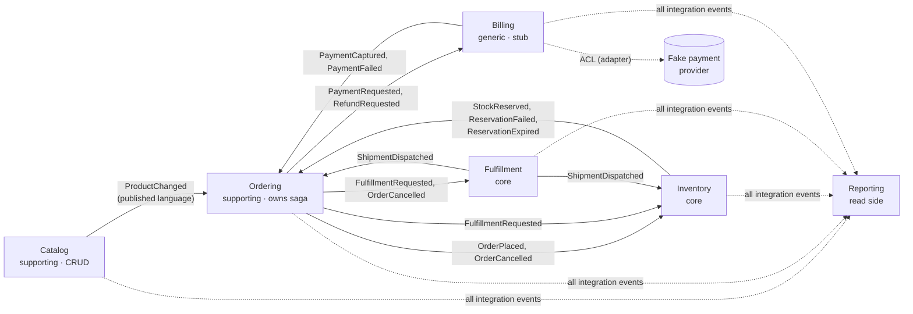

# Context Map

## Contexts

| Context | Subdomain type | Model style | Owns |
| --- | --- | --- | --- |
| Inventory | Core | Rich aggregates (`StockItem`, `StockCount`), domain service (`IAllocationStrategy`) | Locations, stock items, reservations, counts |
| Fulfillment | Core | Rich aggregate (`PickList`) | Pick lists, picks, shipments |
| Ordering | Supporting | Aggregate (`Order`) + process manager (`OrderFulfillmentProcess`) | Orders, product copy, the saga |
| Catalog | Supporting | Plain CRUD | Products |
| Billing | Generic (stub) | Small aggregate (`Payment`) + anti-corruption layer | Payments, refund flags |
| Reporting | Read side (not a business context) | Projections | Dashboard read models |

## Relationships

| Upstream → Downstream | Pattern | Notes |
| --- | --- | --- |
| Catalog → Ordering | Published language + downstream copy | Ordering keeps `CatalogProduct` (SKU, price, active, version). Never references `Product`. |
| Ordering ↔ Inventory | Published language (events), partnership | Inventory reacts to `OrderPlaced`, `OrderCancelled`, `FulfillmentRequested`; Ordering's saga reacts to reservation events. |
| Ordering ↔ Billing | Customer/supplier via events | Billing is a supplier of payment outcomes. |
| Billing → payment provider | Anti-corruption layer | Provider types live only in `Billing.Infrastructure`. |
| Ordering → Fulfillment | Customer/supplier via events | `FulfillmentRequested` carries everything Fulfillment needs (SKU, location, quantity, reservation ID). |
| Fulfillment → Inventory, Ordering | Published language | `ShipmentDispatched`. |
| All → Reporting | Conformist | Reporting consumes contracts as-is. |

## Shared kernel

`FulfillmentFlow.SharedKernel` holds only identity-free primitives every context agrees on: `Sku`, `Quantity`, `Money`, `GeoPoint`, base types (`Entity`, `AggregateRoot`, `ValueObject`, `IDomainEvent`), and `Result`/`DomainError`. It has no reference to any context. Adding to it requires an ADR. (ADR-0004)

## Rules

1. A context's `*.Contracts` project is the only thing other contexts may reference.
2. Contracts contain only `record` integration events with primitive or contract-local types (no SharedKernel types, so contracts stay serialisable and versionable). They reference only `FulfillmentFlow.BuildingBlocks.Contracts` (the `IIntegrationEvent` interface).
3. No context queries another context's tables.
