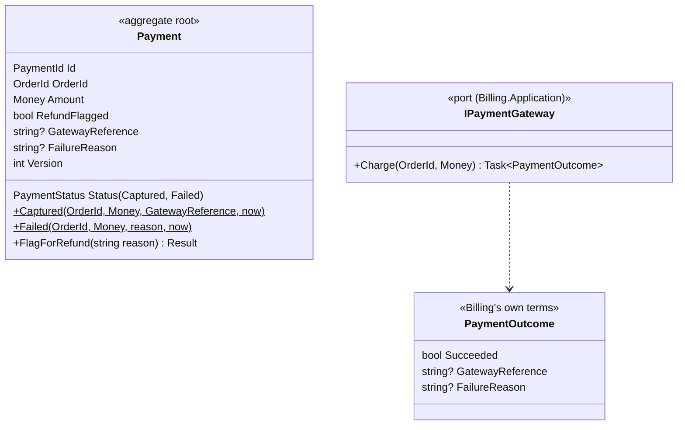

# Billing Context (generic, stubbed)

Requirements: BIL-1 … BIL-3. A real business would buy this, so the model is small. Its purpose in the demo is the **anti-corruption layer** (BIL-2).

## Model



## Anti-corruption layer (Billing.Infrastructure)

```
FakePay/                      provider-shaped code; nothing outside this folder sees it
  FakePayClient               returns FakePayChargeResponse { "status": "APPROVED" | "DECLINED", "txn_ref": "...", "decline_code": "..." }
  FakePayChargeResponse       the provider's own DTO, snake_case JSON
  FakePayTranslator           FakePayChargeResponse → PaymentOutcome
FakePayPaymentGateway         implements IPaymentGateway using client + translator
```

`FakePayClient` declines when the amount equals `Billing:FailWhenAmountEquals` (default `13.13`) (BIL-1.2). An architecture test asserts no type in namespace `*.FakePay` is referenced from `Billing.Domain` or `Billing.Application` (BIL-2.1).

## Application layer

| Handler | Trigger | Behaviour |
| --- | --- | --- |
| `ChargeForOrder` handles `PaymentRequestedIntegrationEvent` | event | If a `Payment` for the order exists → no-op (BIL-1.3). Else call gateway, save `Payment`, raise `PaymentCaptured` / `PaymentFailed`. |
| `FlagRefund` handles `RefundRequestedIntegrationEvent` | event | Captured payment → `FlagForRefund` → `RefundFlagged`. None or failed → record and ignore (BIL-3.2). Already flagged → no-op. |

The gateway call happens before the save. If the process crashes after charging and before saving, a retry charges again; acceptable for a stub and noted in ADR-0010 as a real-world concern (a real provider would take an idempotency key, which `Charge` passes as the `OrderId`).

## Persistence (prefix `billing_`)

`billing_Payments` (unique `OrderId`), `billing_Outbox`, `billing_Inbox`.
