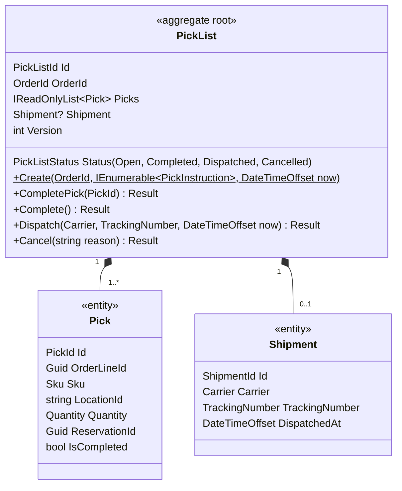

# Fulfillment Context (core)

Requirements: FUL-1 … FUL-4.

## Model

`Shipment` sits inside `PickList` because one order has one shipment and dispatch must check the list is completed in the same transaction (NFR-3). `Carrier` and `TrackingNumber` are value objects (non-empty, ≤ 64 chars).

### Rules in code

| Method | Rejects with | Raises | Req |
| --- | --- | --- | --- |
| `Create` | `fulfillment.pick-list-needs-picks` | `PickListCreated` | FUL-1.1 |
| `CompletePick` | `fulfillment.pick-not-found`, `fulfillment.pick-list-not-open` | `PickCompleted` (internal; no-op if already completed) | FUL-2.3 |
| `Complete` | `fulfillment.picks-incomplete`, `fulfillment.pick-list-not-open` | `PickListCompleted` | FUL-2.1, 2.2 |
| `Dispatch` | `fulfillment.pick-list-not-completed`, `fulfillment.carrier-required`, `fulfillment.tracking-number-required` | `ShipmentDispatched` | FUL-3 |
| `Cancel` | — (no-op when Dispatched or Cancelled) | `PickListCancelled` | FUL-4 |

## Application layer

| Command / handler | Trigger |
| --- | --- |
| `CreatePickList` handles `FulfillmentRequestedIntegrationEvent` | event; idempotent by unique `OrderId` (FUL-1.2) |
| `CancelPickList` handles `OrderCancelledIntegrationEvent` | event; no pick list → ignore |
| `CompletePick`, `CompletePickList`, `DispatchShipment` | API |

## Persistence (prefix `fulfillment_`)

`fulfillment_PickLists` (unique `OrderId`), `fulfillment_Picks`, `fulfillment_Shipments`, `fulfillment_Outbox`, `fulfillment_Inbox`.
