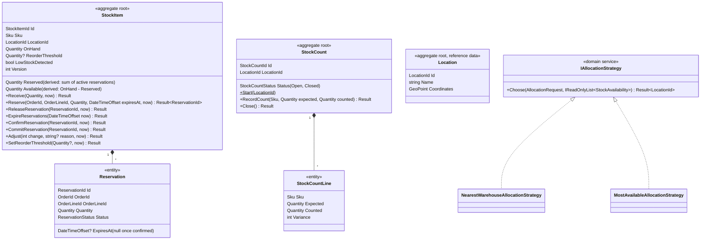

# Inventory Context (core)

Invariants: **available ≥ 0** and **on-hand ≥ reserved**, always. Requirements: INV-1 … INV-8.

## Model

### Value objects and IDs

- `StockItemId`, `ReservationId`, `StockCountId`: `readonly record struct` wrapping a `Guid` (v7). `LocationId`: wraps an uppercase code string (e.g. `SEA-1`, 2–16 chars).
- `OrderId`, `OrderLineId` in Inventory are Inventory's own ID types (wrapping the Guid from the contract), not Ordering's types.
- `AllocationRequest(Sku, Quantity, GeoPoint destination)`; `StockAvailability(LocationId, GeoPoint, Quantity available)`.
- Release vs expiry is distinguished by the resulting `ReservationStatus` (`Released` or `Expired`) and event (`ReservationReleased` or `ReservationExpired`).

### Rules in code

| Method | Rejects with | Raises | Req |
| --- | --- | --- | --- |
| `StockItem.Create(sku, location)` + `Receive(q)` | `inventory.quantity-must-be-positive` | `StockReceived` | INV-1 |
| `Reserve(orderId, lineId, q, expiresAt)` | `inventory.quantity-must-be-positive`, `inventory.insufficient-stock` | `StockReserved` (not on idempotent repeat) | INV-2 |
| `ReleaseReservation(id, now)` | `inventory.reservation-not-found` | `ReservationReleased` (no-op if not active) | INV-3.1, 3.3 |
| `ExpireReservations(now)` | — | `ReservationExpired` per expired reservation | INV-3.2, 3.4 |
| `ConfirmReservation(id)` | `inventory.reservation-not-active` | `ReservationConfirmed` (no-op if already confirmed) | INV-3.4 |
| `CommitReservation(id)` | `inventory.reservation-not-active` | `ReservationCommitted` (no-op if committed) | INV-4 |
| `Adjust(change, reason)` | `inventory.adjustment-reason-required`, `inventory.adjustment-must-change-quantity`, `inventory.on-hand-below-reserved` | `StockAdjusted` | INV-5 |
| `SetReorderThreshold(t)` | — | `ReorderThresholdSet`, maybe `LowStockDetected` | INV-7.3 |
| after any change | — | `LowStockDetected` / `LowStockCleared` on threshold crossing | INV-7 |
| `StockCount.RecordCount` | `inventory.stock-count-closed` | — | INV-8.1 |
| `StockCount.Close` | `inventory.stock-count-closed`, `inventory.stock-count-empty` | `StockCountClosed` with proposed adjustments | INV-8.2–8.5 |

All methods take time as a parameter (`DateTimeOffset now` / `expiresAt`); the domain never reads a clock.

## Allocation strategies (INV-6)

- `NearestWarehouseAllocationStrategy` (default): filter candidates with `available ≥ requested`; order by haversine distance to destination, then by `LocationId` ordinal; first wins; none → `inventory.no-location-can-supply`.
- `MostAvailableAllocationStrategy`: same filter; order by available descending, then `LocationId`. Exists to prove INV-6.3.
- Selected by configuration `Inventory:AllocationStrategy` (`Nearest` | `MostAvailable`) in the composition root.

## Application layer

| Command / handler | Trigger | Transactions |
| --- | --- | --- |
| `ReceiveStock(sku, locationId, quantity)` | API | 1 stock item (created if missing) |
| `AdjustStock(sku, locationId, change, reason)` | API | 1 stock item |
| `SetReorderThreshold(sku, locationId, threshold?)` | API | 1 stock item |
| `RegisterLocation(id, name, lat, lon)` | API / seed | 1 location |
| `StartStockCount(locationId)`, `RecordCount(countId, sku, counted)`, `CloseStockCount(countId)` | API | 1 count (expected read from stock item when recording) |
| `ReserveStockForOrder` handles `OrderPlacedIntegrationEvent` | event | 1 per line; stops at first failure and writes `ReservationFailed` to outbox |
| `ReleaseOrderReservations` handles `OrderCancelledIntegrationEvent` | event | 1 per stock item holding an active reservation for the order |
| `ConfirmOrderReservations` handles `FulfillmentRequestedIntegrationEvent` | event | 1 per reservation |
| `CommitShipmentReservations` handles `ShipmentDispatchedIntegrationEvent` | event | 1 per reservation |
| `ApplyStockCountAdjustments` handles `StockCountClosed` | event | 1 per adjustment |
| `ExpireReservationsJob` (background, every 30 s) | timer | 1 per stock item with an expired reservation |

Multi-transaction handlers rely on domain-level idempotency (INV-2.4, INV-3.3, INV-4.3) so a retry after a partial run is safe (ADR-0018).

## Persistence (SQLite, prefix `inventory_`)

`inventory_Locations`, `inventory_StockItems` (unique `Sku, LocationId`), `inventory_Reservations` (index `OrderId`, unique `StockItemId, OrderLineId`), `inventory_StockCounts`, `inventory_StockCountLines`, `inventory_Outbox`, `inventory_Inbox`.
