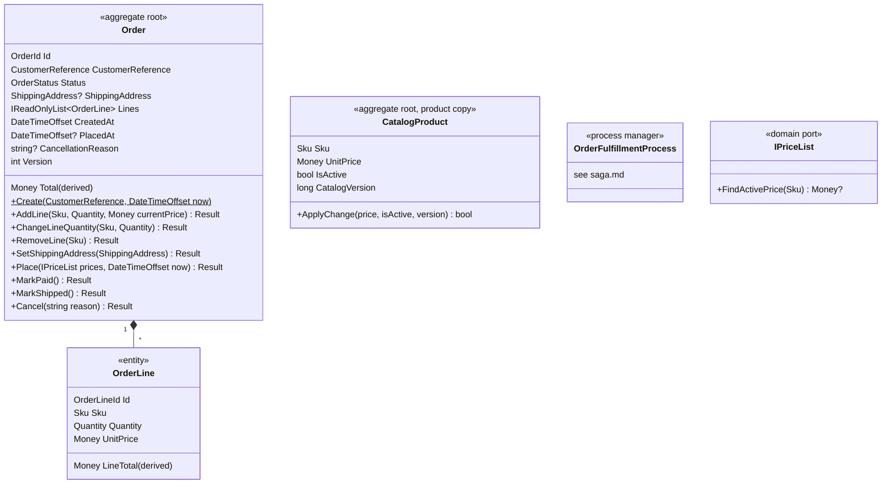

# Ordering Context (supporting, owns the saga)

Requirements: ORD-1 … ORD-5, SAGA-1 … SAGA-7, CAT-2.2.

## Model

- `OrderStatus` transitions live in one private method guarded by a transition table (ORD-3.1). There is no public status setter.
- `ShippingAddress(Line1, City, PostalCode, CountryCode, GeoPoint)` value object; all strings required, `CountryCode` is ISO 3166-1 alpha-2.
- `CustomerReference`: non-empty, ≤ 64 chars.
- `IPriceList` is an interface in the Domain; the application layer implements it over `CatalogProduct` rows. `Place` re-prices every line from it (ORD-5.1) and rejects unknown/inactive SKUs (ORD-5.4).
- `Total` is computed from lines, never stored separately in the aggregate (ORD-5.3). It may be persisted as a column for queries.

### Rules in code

| Method | Rejects with | Raises | Req |
| --- | --- | --- | --- |
| `AddLine` | `ordering.order-not-draft`, `ordering.quantity-must-be-positive` | `OrderLineAdded` (internal) | ORD-1.2–1.4 |
| application `AddOrderLine` | `ordering.unknown-sku` (lookup in product copy) | — | ORD-1.5 |
| `ChangeLineQuantity`, `RemoveLine` | `ordering.order-not-draft`, `ordering.line-not-found` | internal | ORD-1.6 |
| `SetShippingAddress` | `ordering.order-not-draft` | internal | ORD-1.7 |
| `Place` | `ordering.order-has-no-lines`, `ordering.shipping-address-required`, `ordering.unknown-sku`, `ordering.order-not-draft` | `OrderPlaced` | ORD-2, ORD-5 |
| `MarkPaid`, `MarkShipped` | `ordering.invalid-status-transition` | `OrderPaid`, `OrderShipped` | ORD-3 |
| `Cancel` | `ordering.cancellation-reason-required`, `ordering.invalid-status-transition` | `OrderCancelled` | ORD-4 |

## Application layer

| Command / handler | Trigger |
| --- | --- |
| `CreateOrder`, `AddOrderLine`, `ChangeOrderLineQuantity`, `RemoveOrderLine`, `SetShippingAddress`, `PlaceOrder`, `CancelOrder` | API |
| `MarkOrderPaid`, `MarkOrderShipped`, `CancelOrder` (internal) | outbox command from the saga |
| `UpdateProductCopy` handles `ProductChangedIntegrationEvent` | event (CAT-2.2 version check) |
| `OrderFulfillmentProcessHandler` handles `OrderPlaced`, `StockReserved`, `ReservationFailed`, `ReservationExpired`, `PaymentCaptured`, `PaymentFailed`, `ShipmentDispatched`, `OrderCancelled` integration events | events |

## Persistence (prefix `ordering_`)

`ordering_Orders`, `ordering_OrderLines`, `ordering_CatalogProducts`, `ordering_FulfillmentProcesses` (state as columns + JSON for reservations/history), `ordering_Outbox`, `ordering_Inbox`.
