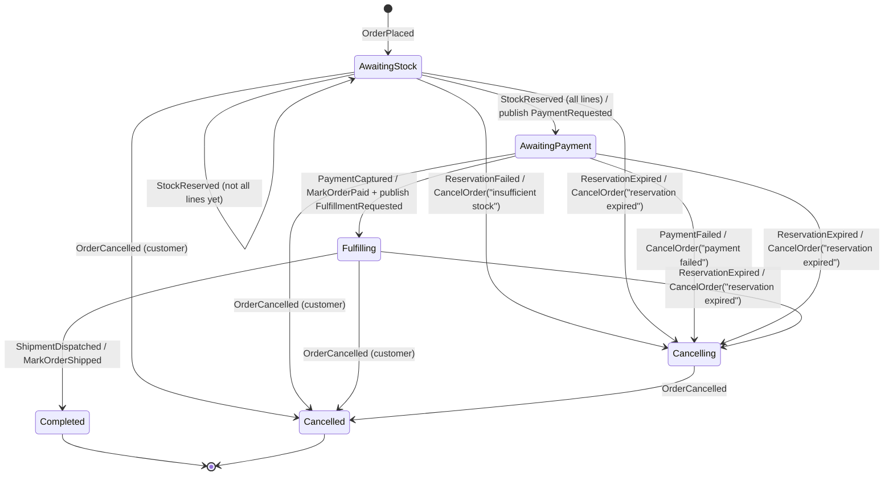
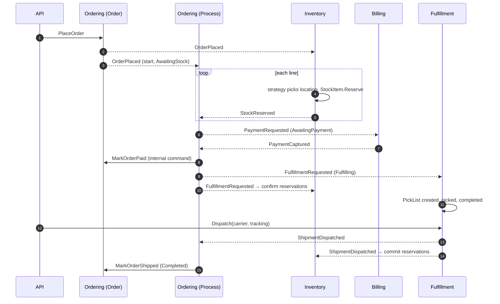
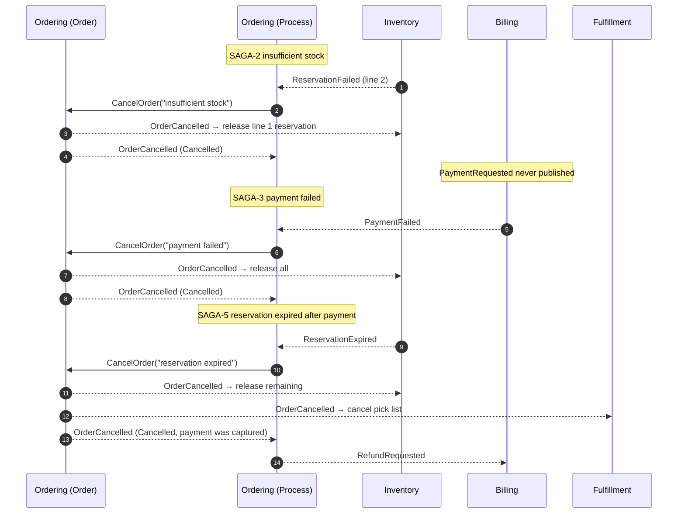

# Order Fulfillment Process (Saga)

`OrderFulfillmentProcess` is a process manager in the Ordering module (ADR-0007). One instance per placed order, keyed by `OrderId`, persisted in `ordering_FulfillmentProcesses`.

## Responsibilities

- React to integration events about its order.
- Track which order lines have a reservation.
- Publish `PaymentRequested`, `FulfillmentRequested`, `RefundRequested`, `OrderFulfillmentStepChanged`.
- Send internal commands to Ordering (`MarkOrderPaid`, `MarkOrderShipped`, `CancelOrder`) via the outbox, so `Order` changes in its own transaction (NFR-3).
- Record every message it receives (ID, type, time, outcome) in its history: applied, duplicate, or ignored (SAGA-6, SAGA-7).

It never touches Inventory, Billing or Fulfillment directly.

## State

| Field | Meaning |
| --- | --- |
| `OrderId` | Identity |
| `Step` | `AwaitingStock`, `AwaitingPayment`, `Fulfilling`, `Cancelling`, `Completed`, `Cancelled` |
| `ExpectedLines` | Order line IDs from `OrderPlaced` |
| `Reservations` | Line ID → (reservation ID, SKU, location, quantity) from `StockReserved` |
| `PaymentCaptured` | bool + amount (for refunds) |
| `EndReason` | Set when it reaches `Completed` or `Cancelled` |
| `ProcessedMessageIds` | For de-duplication (SAGA-6.1) |
| `History` | List of entries (at, message type, step before → after, note) |

## State machine

`Cancelling` means "the saga asked Ordering to cancel and is waiting for `OrderCancelled`". The end reason is the saga's reason, or the customer's reason when the customer cancelled.

**Refund rule (one place):** whenever the process enters `Cancelled` and `PaymentCaptured` is true, it publishes `RefundRequested` exactly once. This covers SAGA-4.2, SAGA-5.1 and SAGA-6.3.

## Happy path

## Failure paths

## Late and duplicate messages (SAGA-6)

| Message | In a terminal step | Action |
| --- | --- | --- |
| Any message whose ID is already processed | any | History "duplicate"; no change |
| `StockReserved`, `ReservationFailed`, `ReservationExpired`, `PaymentFailed`, `ShipmentDispatched` | `Completed` / `Cancelled` | History "ignored"; no change |
| `PaymentCaptured` | `Cancelling` | Record `PaymentCaptured = true` (refund follows on entering `Cancelled`); no step change |
| `PaymentCaptured` | `Cancelled` | History "ignored" for state; publish `RefundRequested` if not already published (SAGA-6.3) |
| `StockReserved` for a line already reserved | non-terminal | History "duplicate"; no change |

## Rules for the implementation

- The process is persisted with a `Version` concurrency token. Its handler transaction writes the process row, its outbox rows, and the inbox row only.
- Methods are pure: `Handle(StockReservedIntegrationEvent e, DateTimeOffset now)` returns nothing and records outgoing messages in `PendingMessages`, which the repository moves to the outbox. This makes every saga rule a plain unit test.
- `OrderPlaced` for an order that already has a process is a duplicate.
- Messages for an order with no process (for example `OrderCancelled` from a Draft order) are ignored by the saga handler.
