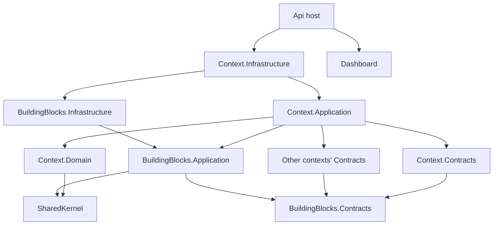

# Architecture

A modular monolith in .NET 9: one ASP.NET Core process hosting the REST API, the Blazor Server dashboard, background workers, and six modules (five bounded contexts plus Reporting). One SQLite database file; each module owns its tables (prefix) and its own `DbContext`.

## Solution layout

```
FulfillmentFlow.sln
Directory.Build.props            net9.0, Nullable enable, ImplicitUsings, TreatWarningsAsErrors, LangVersion latest
Directory.Packages.props         Central package management (all versions pinned here)
.editorconfig
src/
  BuildingBlocks/
    FulfillmentFlow.BuildingBlocks.Contracts/        IIntegrationEvent only                                    (no refs)
    FulfillmentFlow.SharedKernel/                    Sku, Quantity, Money, GeoPoint, Entity, AggregateRoot, ValueObject,
                                                     IDomainEvent, Result, Result<T>, DomainError            (no package refs)
    FulfillmentFlow.BuildingBlocks.Application/      ICommand, ICommandHandler<>, IIntegrationEvent, IIntegrationEventHandler<>,
                                                     IClock, ICommandDispatcher, IUnitOfWork marker              (refs SharedKernel)
    FulfillmentFlow.BuildingBlocks.Infrastructure/   OutboxMessage, InboxMessage, ModuleDbContext base, OutboxProcessor,
                                                     InProcessMessageBus, IdempotencyStore, SystemClock          (EF Core, SQLite)
  Modules/
    Inventory/
      FulfillmentFlow.Inventory.Domain/
      FulfillmentFlow.Inventory.Application/
      FulfillmentFlow.Inventory.Infrastructure/      InventoryDbContext, repositories, mappers, ExpireReservationsJob
      FulfillmentFlow.Inventory.Contracts/           integration event records only
    Ordering/      (.Domain .Application .Infrastructure .Contracts)   saga lives in .Domain (state) + .Application (handler)
    Fulfillment/   (.Domain .Application .Infrastructure .Contracts)
    Billing/       (.Domain .Application .Infrastructure .Contracts)   FakePay ACL in .Infrastructure/FakePay
    Catalog/
      FulfillmentFlow.Catalog/                       CRUD: entity, service, DbContext
      FulfillmentFlow.Catalog.Contracts/
    Reporting/
      FulfillmentFlow.Reporting/                     projections, read-model DbContext, queries, rebuild
  FulfillmentFlow.Api/                               Host: Program.cs, minimal API endpoint groups, problem details,
                                                     idempotency filter, module registration, hosts the dashboard
  FulfillmentFlow.Dashboard/                         Razor Class Library: Blazor Server components + typed API client
tests/
  FulfillmentFlow.Inventory.Domain.Tests/
  FulfillmentFlow.Ordering.Domain.Tests/             includes saga (OrderFulfillmentProcess) tests
  FulfillmentFlow.Fulfillment.Domain.Tests/
  FulfillmentFlow.Billing.Tests/                     domain + ACL translator
  FulfillmentFlow.Application.Tests/                 handlers with in-memory repositories (no EF)
  FulfillmentFlow.IntegrationTests/                  WebApplicationFactory + SQLite in-memory, outbox drained synchronously
  FulfillmentFlow.ArchitectureTests/                 NetArchTest rules
```

## Allowed project references



| Project | May reference | Must not reference |
| --- | --- | --- |
| `*.Domain` | SharedKernel | Anything else (NFR-1) |
| `*.Contracts` | BuildingBlocks.Contracts only | SharedKernel, any module |
| `BuildingBlocks.Application` | SharedKernel, BuildingBlocks.Contracts | any module |
| `*.Application` | own Domain, own Contracts, other contexts' Contracts, BuildingBlocks.Application | other contexts' Domain/Application/Infrastructure, EF Core, ASP.NET |
| `*.Infrastructure` | own Application, BuildingBlocks.Infrastructure, EF Core | other contexts' Domain/Application/Infrastructure |
| `Reporting` | all Contracts, BuildingBlocks | any Domain/Application/Infrastructure |
| `Dashboard` | nothing from modules (talks HTTP; has its own DTOs) | all modules |
| `Api` | everything (composition root) | — |

Each module exposes one `public static class <Context>Module { IServiceCollection Add<Context>Module(this IServiceCollection, IConfiguration); }` from Infrastructure. Everything else is `internal` where practical.

## Request flow (command)

```mermaid
sequenceDiagram
    participant C as Client
    participant E as Endpoint (Api)
    participant H as Command handler (Application)
    participant R as Repository (Infrastructure)
    participant AG as Aggregate (Domain)
    participant DB as SQLite

    C->>E: POST /inventory/receipts (Idempotency-Key)
    E->>E: idempotency filter: seen key? replay
    E->>H: ReceiveStock command
    H->>R: Get(sku, location)
    H->>AG: Receive(quantity) → Result
    H->>R: Save(aggregate)
    R->>DB: BEGIN; update aggregate (Version check); insert outbox rows (mapped events); COMMIT
    H-->>E: Result
    E-->>C: 200 / problem details
```

## Messaging

- **Domain events** are collected on `AggregateRoot.DomainEvents`. The module's repository `Save` maps them to integration events (`I<Context>IntegrationEventMapper`) and inserts them as `OutboxMessage` rows in the same `SaveChanges` (NFR-4). Unmapped (internal) domain events are not written.
- **Internal commands** (Ordering saga → Ordering) are also outbox rows with `Kind = Command`.
- **OutboxProcessor** (one `BackgroundService` per module, poll interval `Messaging:PollIntervalMs`, default 500) reads unprocessed rows in `Sequence` order, deserialises, and hands them to `InProcessMessageBus`, which calls every registered `IIntegrationEventHandler<T>` across all modules (or the one `ICommandHandler<T>` for commands). Success → `ProcessedAt` set. Failure → `Attempts++`, `NextAttemptAt` with exponential backoff; after 5 attempts → `DeadLetteredAt` (NFR-11).
- Each handler invocation is isolated: one handler failing does not mark the message failed for other handlers. Delivery is tracked per (message, handler) in the **consumer's** `Inbox` table (`MessageId`, `HandlerName`, `ProcessedAt`), which also gives idempotency (NFR-5, ADR-0018).
- **Outbox rows are never deleted.** Together they are the event log used to rebuild read models (DASH-3, ADR-0006).
- Integration tests use `IOutboxDrainer.DrainAsync()` to process all outboxes until empty instead of waiting for the timer.

## Persistence

- One SQLite file (`ConnectionStrings:FulfillmentFlow`, default `Data Source=fulfillmentflow.db`), WAL mode, `busy_timeout=5000`.
- Each module has its own `DbContext` and EF migrations folder, tables prefixed (`inventory_`, `ordering_`, …) because SQLite has no schemas (ADR-0020).
- Aggregates are mapped with private fields/backing fields; no public setters (NFR-8). Value objects as owned types or value converters.
- Concurrency: `int Version` property configured `IsConcurrencyToken()`, incremented by the repository on save (NFR-10).
- `DateTimeOffset` stored as ISO-8601 text via converter (SQLite cannot order native `DateTimeOffset`); `decimal` stored as text via converter to keep precision.
- Migrations are applied at startup in Development and in tests (`Database.MigrateAsync()` per module).

## Errors

- Domain and application code return `Result` / `Result<T>` carrying a `DomainError(Code, Message, RequirementId?)`. No exceptions for rule violations (ADR-0014).
- The API maps codes to HTTP status via `docs/04-contracts/error-catalog.md` (a static dictionary in `Api/Errors/ErrorCatalog.cs`), returning RFC 9457 problem details. Unknown codes default to `422` and log a warning. Unhandled exceptions → `500` problem details, which tests treat as failures (API-3).

## Time

`IClock` (BuildingBlocks.Application) with `SystemClock` and `FakeClock` (tests). Domain methods receive `DateTimeOffset now` as a parameter.

## Background workers (hosted in Api)

| Worker | Interval | Purpose |
| --- | --- | --- |
| `OutboxProcessor<TContext>` × 5 modules | 500 ms | publish messages |
| `ExpireReservationsJob` | 30 s (`Inventory:ExpiryCheckIntervalSeconds`) | INV-3.2 |

Workers are disabled in integration tests (`Messaging:Enabled=false`) and driven manually.

## Read side (Reporting)

`FulfillmentFlow.Reporting` registers `IIntegrationEventHandler<T>` projections writing to `reporting_*` tables, plus query services for `GET /views/*`. Rebuild (`POST /admin/read-models/rebuild`): truncate `reporting_*` and `reporting_Inbox`, read every outbox row from every module ordered by `OccurredAt` then `Sequence`, and feed them to Reporting's handlers only.

## Dashboard

Blazor Server (interactive server render mode) components in `FulfillmentFlow.Dashboard`, hosted by the Api. They call the API through a typed `FulfillmentFlowApiClient` (HttpClient, base address = own host) and poll `GET /views/*` every 2 s (DASH-1, DASH-2, ADR-0019). Problem-details responses are shown as an error toast with the code and message.

## Configuration keys

| Key | Default |
| --- | --- |
| `ConnectionStrings:FulfillmentFlow` | `Data Source=fulfillmentflow.db` |
| `Messaging:Enabled` | `true` |
| `Messaging:PollIntervalMs` | `500` |
| `Messaging:MaxAttempts` | `5` |
| `Inventory:ReservationLifetimeMinutes` | `15` |
| `Inventory:ExpiryCheckIntervalSeconds` | `30` |
| `Inventory:AllocationStrategy` | `Nearest` |
| `Billing:FailWhenAmountEquals` | `13.13` |
| `Dashboard:ApiBaseAddress` | own URL |
| `Seed:Enabled` | `true` in Development |
